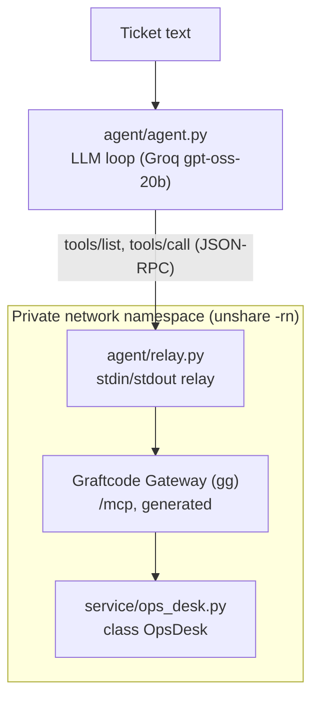

<div align="center">

# Ops Desk MCP Agent

**An autonomous support-desk agent that works customer tickets by calling backend business logic as MCP tools, with no handwritten MCP server or tool wrappers.**


</div>

---

## Overview

Ops Desk reads a customer ticket, looks up the order, checks stock and decides whether a refund is allowed.

- The backend is **one plain Python class** (`service/ops_desk.py`) with four public static methods.
- This repo contains **no MCP server, no tool definitions, no schemas and no API wrapper**.
- The [Graftcode Gateway](https://docs.graftcode.com) (`gg`) hosts the module and exposes each public static method as an MCP tool at `/mcp`, automatically.
- The agent is a **generic MCP client plus an LLM**. It discovers the tools at run time and decides which to call. It knows nothing about Ops Desk.

Built for the Build Verse hackathon (Tech4hack x Graftcode), track **PS11: AI Agents & MCP**.

> **Refunds are a simulation.** `evaluate_refund` only returns `APPROVE`, `NEEDS_HUMAN` or `DENY` from seeded demo data. No money moves and no payment system is called.

## Architecture



| Component | Role | Who wrote it |
| --- | --- | --- |
| `service/ops_desk.py` | Business logic: four static methods over seeded data | This repo |
| Graftcode Gateway | MCP endpoint, tool list, schemas, call routing | Graftcode (generated) |
| `agent/mcp_client.py` | Generic MCP client: initialize, tools/list, tools/call | This repo |
| `agent/relay.py` | Generic JSON-RPC relay over stdin/stdout | This repo |
| `agent/agent.py` | Converts discovered tools to LLM function schemas and loops until a decision | This repo |

## How Graftcode is used

1. **Write ordinary Python.** `class OpsDesk` exposes `get_order`, `list_customer_orders`, `check_stock` and `evaluate_refund` as static methods. No decorators, no framework imports.
2. **Run the Gateway** with `gg --modules ./service/`. It analyses the module and serves Graftcode Vision plus an MCP endpoint (`POST /mcp`, protocol `2025-06-18`). `tools/list` returns one tool per public method, with input and output schemas generated from the Python signatures and docstrings. A capture from a real run is in [`docs/tools-list.json`](docs/tools-list.json).
3. **Point a generic client at it.** The agent discovers the tools, hands them to the model as function schemas, and executes whatever the model chooses.
4. **Optionally publish.** With a Graftcode Project Key, the same module is published to your Portal project registry (generated client packages for npm, NuGet, pip, Maven, gem and Composer). See [Create your own keys](#create-your-own-keys).

## Quick start

### Requirements

- Linux with unprivileged user namespaces, plus `unshare` and `ip` (needed for the default contained mode)
- Python 3
- A free [Groq](https://console.groq.com/keys) API key
- A Graftcode Project Key (required for the hackathon demo, see below)

### 1. Install the gateway

```sh
curl -fsSL grft.dev/get/gg | sh
# Debian/Ubuntu: it downloads gg.deb, then run: sudo dpkg -i gg.deb
```

If you only extract the binary, put its libraries on `LD_LIBRARY_PATH` (for an extracted `.deb`: `usr/lib`) and set `GG=/path/to/gg`.

### 2. Configure

```sh
cp .env.example .env
# edit .env and set GROQ_API_KEY and GC_PROJECT_KEY
```

### 3. Run the agent (default, contained)

```sh
GG=/path/to/gg sh agent/run_agent.sh "Customer Maya Rao asks for a refund on order A1001. Decide."
```

The gateway starts inside a private network namespace, Groq is called from the host, and MCP requests reach the gateway through the generic stdin/stdout relay. No gateway port is opened on any host network interface.

### 4. Run the tests

```sh
GG=/path/to/gg sh run_tests.sh
```

`run_tests.sh` runs 18 offline unit tests (policy boundaries, provider retry and failure handling, argument guard, limits; no gateway, network or key needed), then the gateway integration test. Run `sh agent/preflight.sh` first to check Linux, `unshare`, `ip`, user namespaces and `gg`.

The integration test uses a scripted model, so no key is needed. It proves tool discovery and real tool calls through the gateway. It does not measure model quality.

### Optional: uncontained mode

`./run.sh` starts the gateway on the host network (ports 80 and 81 by default, or `GG_ARGS="--port 18080 --httpPort 18081"`). It listens on **all interfaces**. Use it only for Graftcode Vision (`http://localhost:81/GV`) or an external MCP client, on a trusted network or behind a firewall. Then set `MCP_URL=http://localhost:81/mcp` for the agent.

You can also point Cursor or Claude Desktop at the endpoint instead of the agent:

```json
{"mcpServers": {"opsdesk": {"url": "http://localhost:81/mcp"}}}
```

Claude Desktop needs `npx mcp-remote http://localhost:81/mcp`.

> If the scripts are not executable after cloning, run them with `sh`, as shown above.

## Create your own keys

Nothing is shared and no key is stored in this repository.

| Key | Where to create it | Where it goes |
| --- | --- | --- |
| **Groq API key** (free) | [console.groq.com/keys](https://console.groq.com/keys), then Create API Key. Check your plan limits for `openai/gpt-oss-20b`. | `GROQ_API_KEY` in your local `.env` |
| **GraftCode Project Key** | [portal.graftcode.com](https://portal.graftcode.com), then Settings, Project keys, Add new key (Personal). Format `username:token`, shown once. | `GC_PROJECT_KEY` in your local `.env` |

- **Required for the hackathon demo:** the gateway runs locally without a Project Key (publishing to the Portal is optional at runtime), but the Build Verse PS11 instructions require one. Create your own fresh key and run the gateway with it before demoing or submitting.
- The key used during development was **revoked and will not work**.
- Remove a key from the Portal when you are done with it.
- `.env` is listed in `.gitignore`. Never commit it.

## Containment and security

| Mode | Command | Gateway reachable from |
| --- | --- | --- |
| **Contained (default)** | `agent/run_agent.sh`, `agent/test_agent.py` | Nothing on the host network. Only the relay, inside the namespace. |
| **Uncontained (opt-in)** | `./run.sh`, `MCP_URL=...` | **Every network interface.** Not local-only. |

- The gateway (`gg` v1.5.1) binds `0.0.0.0` and has no bind-address option. The default launchers therefore run it in a private Linux network namespace (`unshare -rn`).
- Verified on Linux: no gateway listener appeared on the host, the test passed, and two real gpt-oss-20b runs completed through the relay ([`docs/contained_run.log`](docs/contained_run.log)).
- Containment needs unprivileged user namespaces. On macOS, Windows or locked-down hosts it does not work. Use a container that publishes only on `127.0.0.1` (not tested here) or a host firewall.
- **There is no call authentication.** The Project Key authenticates publication to your Portal project, not individual calls. Anyone who can reach the gateway ports can call the tools. Never expose them through port forwarding, tunnels or public hosts without adding authentication. The data is fake and the methods are read-only. For real use, validate a call credential inside the methods (Graftcode docs: "Authenticate Graft calls").

## Sample run

Real gpt-oss-20b via Groq against the real gateway, logged in [`docs/real_run.log`](docs/real_run.log):

```text
TICKET: Dev Patel wants a refund for order A1002 because the bottle leaks. Also is the Steel Bottle back in stock?
TOOL get_order({"order_id": "A1002"}) -> A1002 | customer=Dev Patel | item=Steel Bottle x2 | sku=BT-11 | ...
TOOL evaluate_refund({"order_id": "A1002"}) -> DENY: outside 30 day refund window
TOOL check_stock({"sku": "BT-11"}) -> BT-11: 0 units in stock
AGENT: ... DECISION: DENY - outside 30 day refund window
```

Through the contained path ([`docs/contained_run.log`](docs/contained_run.log)):

```text
### Customer Maya Rao asks for a refund on order A1001. Decide.
TOOL evaluate_refund({"order_id": "A1001"}) -> APPROVE: within window and limit
AGENT: DECISION: APPROVE - Customer is within refund window and meets policy limits.
```

## Demo data and policy

| Order | Customer | Item (SKU) | Total | Status |
| --- | --- | --- | --- | --- |
| A1001 | Maya Rao | Trail Backpack (BP-20) | $79 | Delivered 4 days ago |
| A1002 | Dev Patel | Steel Bottle x2 (BT-11) | $36 | Delivered 41 days ago |
| A1003 | Maya Rao | Camp Stove (ST-05) | $120 | Shipped |
| A1004 | Sam Lee | Two-Person Tent (TN-30) | $189 | Delivered 3 days ago |

**Policy:** 30 day refund window, $100 auto-approve limit, anything else returns `NEEDS_HUMAN`.

## Project layout

```text
service/
  ops_desk.py        Business logic (plain Python)
  pyproject.toml     Module metadata read by the gateway
agent/
  agent.py           LLM tool-calling loop
  mcp_client.py      Generic MCP client
  relay.py           Generic stdin/stdout JSON-RPC relay
  contained.sh       Starts the gateway in a private network namespace
  run_agent.sh       Default launcher (contained)
  test_agent.py      Integration test against the gateway
  test_unit.py       Offline unit tests
  preflight.sh       Requirements check
docs/                tools/list capture and run logs
run.sh               Uncontained gateway launcher (opt-in)
run_tests.sh         Unit tests plus integration test
.env.example         Template for local keys
```

## Hardening

What the agent does on failure and bad input:

| Situation | Behaviour |
| --- | --- |
| Provider returns 429, 5xx, a timeout or a network error | Up to 3 retries with backoff (honours `Retry-After`, capped at 30 s). Only the model call is retried. Tool calls are never retried. |
| Provider rejects the key (401 or 403) or no key is set | One clear error line, exit code 2, no traceback |
| Gateway or relay stalls or dies | The client waits at most 45 s, then fails with exit code 3 |
| Ticket empty, over 2000 characters or containing a credential-like string | Rejected before any model call |
| Model sends tool arguments that are malformed, nested, over 200 characters or credential-like | The call is blocked and the model gets an error instead |
| Model never finishes | Stops at 8 steps or a 120 s total budget with an error. The same deadline caps provider retries, backoff and gateway waits. A single blocking read is not force-killed, so it can run until the time left runs out. |
| Model gives no `DECISION:` line | Logged as `NO DECISION`, to be treated as `NEEDS_HUMAN` |

The credential guard and log redaction are pattern checks. They reduce accidental leaks and do not guarantee that no secret can ever appear in a ticket, argument or log.

## Production status

This is a hardened demo, not a production service. These are open launch blockers:

- **No call authentication.** Anyone who can reach the gateway can call the tools. `gg` has no per-call auth hook that this project verified. Real use needs a checked credential inside the methods or an authenticating proxy.
- **No real backend.** Orders, stock and refunds are seeded in-memory demo data. A real system needs a real data source and a decision on who may issue refunds.
- **Refund policy is simulated.** The agent never moves money.
- **No hosting, monitoring or alerting.** Nothing is deployed.
- Containment is verified on Linux only.

## Limitations

- Static, stateless methods only. Graftcode's MCP exposure follows static methods, and the seeded data is read-only.
- Only primitive types and strings are used on the public surface. Lists and dicts returned from methods came back as an unsupported-value placeholder over MCP in testing, so lists are returned as comma-separated strings.
- `gg` must keep running while the agent works. This repo does not include hosting.
- Free Groq limits apply. `gpt-oss` models do not do parallel tool calls, so the agent calls tools one at a time.
- Windows and macOS setups have not been verified.

---

<div align="center">

Designed and developed by Ritesh Sah for Build Verse PS11.

</div>
